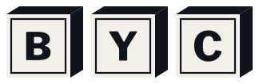

<p align="center">
  <picture>
    <source media="(prefers-color-scheme: dark)" srcset="logos/byc-neg.svg" />
    
  </picture>
</p>

# BYC — el sitio

Este repo es **solo la página web** de BYC: la mesa pública, la lista de espera y el kit de comunicación. No es el brief de la organización ni un dump de marca.

Consultas: [juliocesarsevericheorellana@gmail.com](mailto:juliocesarsevericheorellana@gmail.com)

## Correrlo

```bash
npm install
npm run dev
```

Abre [http://localhost:4173/](http://localhost:4173/). Astro 7, sitio estático.

| Comando | Qué hace |
|---------|----------|
| `npm run dev` | Servidor local en el puerto 4173 |
| `npm run build` | Build de producción |
| `npm run preview` | Sirve el build |

## El mapa

| Ruta | Trabajo |
|------|---------|
| `/` | Una cosa: la mesa y el siguiente paso |
| `/mesa` | Qué hacemos |
| `/para-quien` | Para quién sí y para quién no |
| `/batch` | Batch 01 |
| `/lista` | Lista de espera |
| `/glosa` | Las palabras de esta mesa |
| `/comunica/` | Marca, swag, perfiles |

La portada no carga el kit. El cubo firma. Las señales adornan. Diario: **BYC**. Ceremonial: **BY-COMBINATOR**.

## Qué sí va en la página

- Qué es la mesa, para quién es, qué es el batch.
- La lista de espera.
- Header, footer, Sal/Sombra, las señales como chrome.
- El kit en `/comunica/`: dónde sí y dónde no se usa el cubo.
- Español de Bolivia, tuteo. Bolivia, no una ciudad.
- Fotos de la mesa. Lockups transparentes sobre el campo de la página.

## Qué no va en la página

- El brief interno, la misión reabierta, el unicornio como copy de landing.
- Naranja YC, folklore de turismo, neón crypto, montaña.
- El kit entero en la portada. Por eso hay páginas.
- Voseo argentino (`traé`, `anotate`, `probá`, `acá`).
- Placas `byc-sombra` / `byc-sal` en header o footer: esos archivos traen fondo. En vivo: `byc-neg.svg` sobre sombra, `byc.svg` sobre sal.
- Estirar, rotar o pintar el cubo. Pegarle Bolivia, batch o `.bo`. Frankenlogo.
- La lista de espera en git. En el sitio público llega al correo de contacto; no hay `waitlist.json` en el repo.

Si una palabra suena rara, va a `/glosa`. Si es marca, va a `/comunica/`. Si es para quien busca una silla, va a `/`, `/mesa`, `/para-quien`, `/batch` o `/lista`.

## Cómo contribuir

1. Abrí un issue o un mail **antes** de un cambio grande de voz, marca o arquitectura.
2. Fork y rama desde `main`.
3. `npm run dev`. Mirá la página que tocás y las que comparten header, footer o estado.
4. Un trabajo por PR. Español de Bolivia. El cubo no se disfraza.
5. No subas `.env` ni credenciales.
6. Pedí review. Julio mergea a `main`; GitHub Actions publica en [GitHub Pages](https://bycombinator.github.io/webpage/).

### Checklist

- [ ] La portada sigue haciendo una sola cosa.
- [ ] Sal y Sombra: el texto de los botones contrasta; el lockup no arrastra placa.
- [ ] Si agregaste una palabra de la mesa, está en la glosa.
- [ ] Si tocaste marca, el cambio vive en `/comunica/`, no esparcido.

## Publicar

Push a `main`. Actions construye y publica en [https://bycombinator.github.io/webpage/](https://bycombinator.github.io/webpage/).

GitHub Pages no corre servidor: la lista de espera llega a este correo. La primera vez FormSubmit pide confirmar el buzón.

## Contacto

Julio César Severiche Orellana  
[juliocesarsevericheorellana@gmail.com](mailto:juliocesarsevericheorellana@gmail.com)

Por ahora es el único correo de este repo: bugs, PRs, collabs, dudas de marca.
